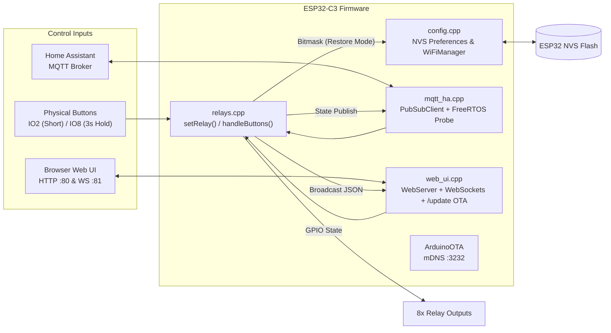
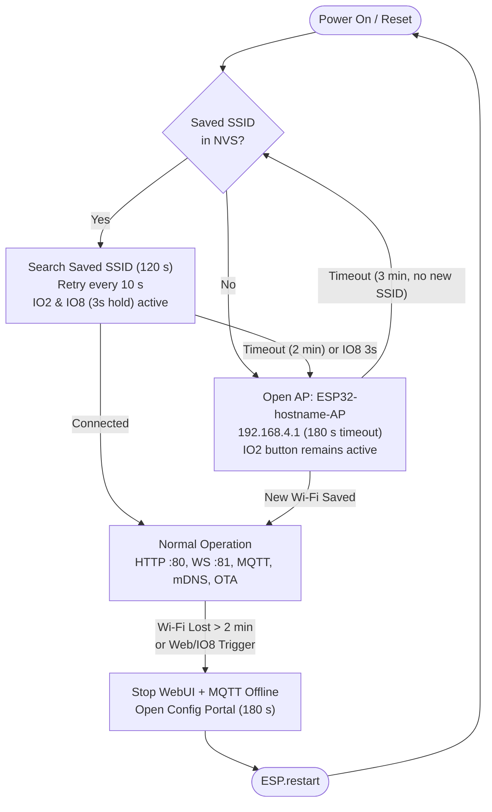

# ESP32-C3 8-Channel Smart Relay Controller (Home Assistant + Web UI)

Firmware for an **ESP32-C3-MINI** 8-channel relay board featuring **Home Assistant MQTT Auto-Discovery**, a **real-time WebSocket Web UI**, **NVS persistence**, **automatic Wi-Fi failover**, and **OTA firmware updates**.

---

## Features

- **8-Channel Active-HIGH Relay Control** with synchronized hardware GPIO, Web UI, and Home Assistant states.
- **Home Assistant MQTT Auto-Discovery**:
  - Automatically registers all 8 relays as switches grouped under a single `<hostname> Controller` device.
  - Uses **Last Will & Testament (LWT)** (`15 s` keep-alive) for accurate `online` / `offline` availability.
  - **Non-blocking FreeRTOS MQTT Probe Task** checks DNS/mDNS and TCP broker reachability every `5 s` without stalling the Web UI or physical buttons.
- **Live Web UI & WebSocket Sync** (HTTP port `80`, WebSocket port `81`):
  - Dynamically renders relay cards from device state JSON.
  - Displays live Hostname, IP, Wi-Fi RSSI (`dBm`), WebSocket status, and MQTT status.
  - Master controls (`All ON`, `All OFF`, `Toggle All`), Power-On State selector, `Config Portal`, and `Reboot` buttons.
  - Optional HTTP Basic Auth (`admin` + configurable password).
- **Physical Button Controls** (Active-LOW with internal pull-up):
  - **Master Toggle (`IO2`)**: Short press performs a smart toggle (turns all OFF if any relay is ON, otherwise turns all ON).
  - **Config Portal (`IO8`)**: 3-second long press safely takes MQTT offline and opens the captive portal AP (`192.168.4.1`).
- **NVS Persistence (`Preferences`)**:
  - Stores hostname, MQTT broker/port/credentials, optional Web/OTA password, power-on behavior (`All OFF`, `All ON`, `Restore Last State`), and an 8-bit relay state bitmask (`relay_mask`, written only when changed).
- **Resilient Wi-Fi Failover & Recovery**:
  - Searches for the saved SSID for **2 minutes** (`120 s`) at boot or after a runtime Wi-Fi outage (retrying every `10 s` while physical buttons remain active).
  - Automatically opens the SoftAP Config Portal (`ESP32-<hostname>-AP` at `192.168.4.1`) for **3 minutes** (`180 s`) if the saved Wi-Fi is not found.
  - If no new SSID is entered before timeout, returns to searching for the saved SSID automatically.
- **Dual OTA Support**:
  - Browser upload via `http://<hostname>.local/update`.
  - PlatformIO / IDE network upload via `ArduinoOTA`.

---

## Hardware Design & Pinout

The PCB, schematic, and design files for this controller live in a separate repository:
- [Smart_home_Board](https://github.com/Mohamed-U3/Smart_home_Board) (ESP32-C3-MINI, 8 relay outputs, 2 user buttons, CH340 USB-to-UART on `UART0` at `115200` baud, plus `Flash` and `Reset` buttons).

> Because programming uses the onboard CH340 USB-to-UART bridge, `GPIO18` and `GPIO19` are free to drive Relays 6 and 5.

| Function | GPIO | Mode / Polarity | Notes |
| --- | --- | --- | --- |
| Relay 1 | `IO0` | `OUTPUT`, Active-HIGH | Default `LOW` unless Power-On mode is ON/Restore |
| Relay 2 | `IO1` | `OUTPUT`, Active-HIGH | |
| Relay 3 | `IO4` | `OUTPUT`, Active-HIGH | |
| Relay 4 | `IO5` | `OUTPUT`, Active-HIGH | |
| Relay 5 | `IO19` | `OUTPUT`, Active-HIGH | |
| Relay 6 | `IO18` | `OUTPUT`, Active-HIGH | |
| Relay 7 | `IO10` | `OUTPUT`, Active-HIGH | |
| Relay 8 | `IO7` | `OUTPUT`, Active-HIGH | |
| Master Button | `IO2` | `INPUT_PULLUP`, Active-LOW | Short press: Smart Toggle All |
| Config Button | `IO8` | `INPUT_PULLUP`, Active-LOW | Hold 3 s: Open Config Portal |

---

## System Architecture



---

## Wi-Fi Failover & Config Portal Flow



For full architecture, sequence, and FreeRTOS task diagrams suitable for presentations, see [docs/SYSTEM_ARCHITECTURE.md](docs/SYSTEM_ARCHITECTURE.md). For the complete hardware product catalog and technical datasheet with 3D PCB renders and electrical ratings, see [docs/PRODUCT_CATALOG.md](docs/PRODUCT_CATALOG.md).

---

## Project Structure

```text
├── platformio.ini              # PlatformIO env (esp32-c3-devkitm-1) & library deps
├── Doxyfile                    # Doxygen + Graphviz configuration
├── README.md                   # Project overview & quickstart
├── docs/
│   ├── PRODUCT_CATALOG.md      # Hardware product catalog & technical datasheet
│   ├── SYSTEM_ARCHITECTURE.md  # Detailed presentation graphs (Mermaid)
│   ├── images/                 # Hardware 3D renders & orthographic PCB photos
│   └── doxygen/html/           # Generated Doxygen HTML + interactive SVG graphs
└── src/
    ├── main.cpp                # Boot orchestration, ArduinoOTA, loop & Wi-Fi monitor
    ├── config.h / config.cpp   # NVS settings, sanitization, Wi-Fi search & portal
    ├── relays.h / relays.cpp   # Relay GPIO control, NVS mask, button debounce/hold
    ├── mqtt_ha.h / mqtt_ha.cpp # HA MQTT discovery, LWT, background probe task
    └── web_ui.h / web_ui.cpp   # Embedded HTML/JS UI, WebSocket sync, /update OTA
```

---

## Getting Started

### 1. Build & Flash (PlatformIO)

```bash
# Build firmware
pio run

# Upload over USB
pio run -t upload

# Serial monitor (115200 baud)
pio device monitor -b 115200
```

### 2. First-Time Provisioning

1. Power on the board; if no Wi-Fi credentials exist, it opens SoftAP **`ESP32-module1-AP`**.
2. Connect to the AP and open **`http://192.168.4.1`**.
3. Configure:
   - **Wi-Fi SSID & Password**
   - **Custom Hostname** (e.g., `module1` → reachable at `http://module1.local`)
   - **MQTT Broker**, **Port** (`1883`), **Username**, **Password**
   - **Web UI / OTA Password** *(optional; username is `admin`)*
   - **Power-On Mode** (`0` = All OFF, `1` = All ON, `2` = Restore Last State)
4. Save — the device connects and registers automatically in Home Assistant via MQTT Discovery.

---

## MQTT Topic Reference

Assuming hostname `<hostname>` (default `module1`):

| Purpose | Topic | Payload |
| --- | --- | --- |
| Availability (LWT) | `homeassistant/switch/<hostname>/status` | `online` / `offline` (retained) |
| HA Discovery (`0..7`) | `homeassistant/switch/<hostname>/relay<N>/config` | JSON switch + device object (retained) |
| Relay State (`0..7`) | `homeassistant/switch/<hostname>/relay<N>/state` | `ON` / `OFF` (retained) |
| Relay Command (`0..7`) | `homeassistant/switch/<hostname>/relay<N>/set` | `ON` / `OFF` |

---

## OTA Firmware Updates

- **Web Browser**: Open `http://<hostname>.local/update`, select `.pio/build/esp32-c3-devkitm-1/firmware.bin`, and click **Upload & Flash**.
- **PlatformIO (`ArduinoOTA`)**:
  ```bash
  pio run -t upload --upload-port module1.local
  ```

---

## Generating Doxygen Documentation & Graphs

This repository includes a preconfigured [Doxyfile](Doxyfile) with Graphviz call, caller, include, and collaboration graphs enabled.

1. Install **Doxygen** and **Graphviz** (on Windows):
   ```powershell
   winget install DimitriVanHeesch.Doxygen Graphviz.Graphviz
   ```
2. Generate the HTML documentation and graphs:
   ```bash
   doxygen Doxyfile
   ```
3. Open `docs/doxygen/html/index.html` in your browser.
