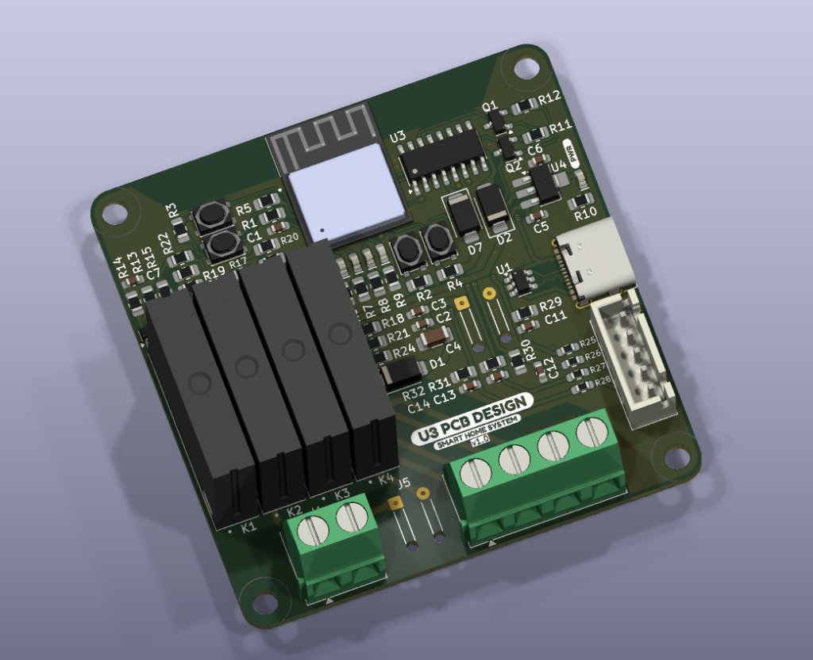
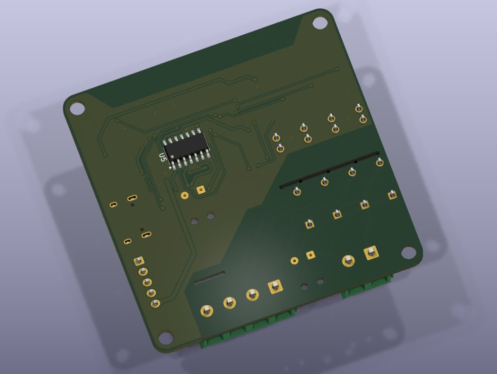
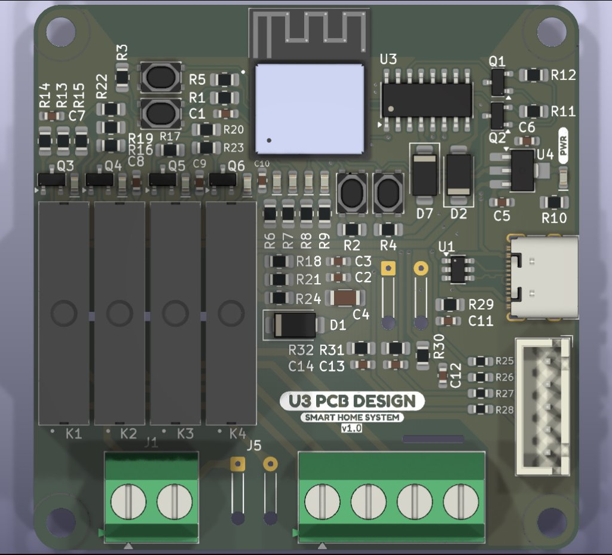
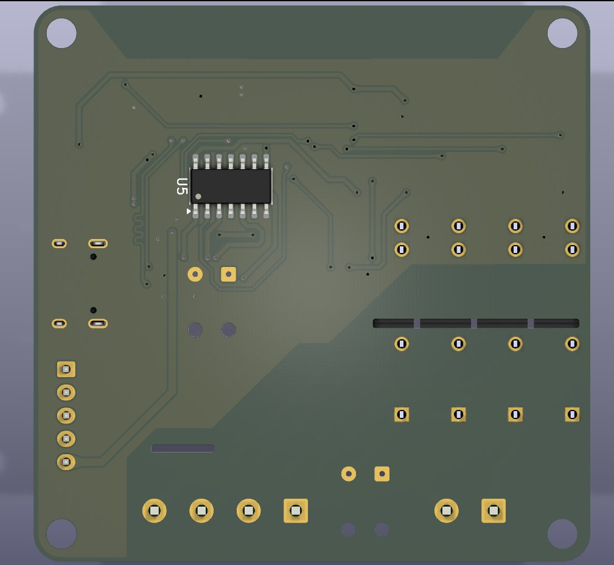

# Product Catalog & Technical Datasheet
## U3 Smart Home System v1.0
### ESP32-C3 8-Channel Smart Relay Controller

> **Designed by:** U3 PCB DESIGN  
> **Firmware:** Home Assistant MQTT + WebSocket Web UI  
> **Hardware Repository:** [Smart_home_Board](https://github.com/Mohamed-U3/Smart_home_Board)  
> **Firmware Repository:** [HomeAssistance_ESP32C3Mini_Firmware](https://github.com/Mohamed-U3/HomeAssistance_ESP32C3Mini_Firmware)  
> **Revision:** v1.0 • Release Date: November 2026

---

## 1. Product Overview

The **U3 Smart Home System v1.0** is an industrial-grade, ultra-compact 8-channel smart relay module powered by the **Espressif ESP32-C3-MINI** 32-bit RISC-V microcontroller. Engineered specifically for home automation, smart switchboards, and IoT cabinet installations, the controller delivers seamless zero-code **Home Assistant MQTT Auto-Discovery**, a **real-time WebSocket Web UI**, and an intelligent **2-minute Wi-Fi failover recovery cycle**.

With native USB Type-C flashing, physical tactile controls, optical high-voltage creepage routing, and non-volatile state restoration, the board represents a robust, production-ready solution for residential and commercial automation.

```
+-----------------------------------------------------------------------------------+
|                           U3 SMART HOME CONTROLLER v1.0                          |
|                                                                                   |
|  [Wi-Fi / BLE 5.0]  <--->  [ESP32-C3 160MHz]  <--->  [8-Channel Isolated Relays]  |
|          |                         |                               |              |
|   Home Assistant             FreeRTOS Core                  High Voltage Load     |
|   Auto-Discovery            NVS Persistence                Milled Air-Gap Slots   |
+-----------------------------------------------------------------------------------+
```

---

## 2. Hardware Gallery & Visual Inspection

### 2.1 3D Perspective Views

| Top 3D Isometric View | Bottom 3D Isometric View |
| :---: | :---: |
|  |  |
| *Top side showing ESP32-C3 module, slimline power relays, USB-C port, tactile buttons & screw terminals* | *Bottom side showing secondary driver IC (U5), copper isolation plane, and high-voltage air-gap milling slots* |

### 2.2 Top & Bottom Orthographic Layout

| Top Orthographic Layout | Bottom Orthographic Layout |
| :---: | :---: |
|  |  |
| *Top silk screen layout: U3 PCB DESIGN SMART HOME SYSTEM v1.0* | *Bottom silk screen layout showing clearance and isolation boundaries* |

---

## 3. Key Features & Highlights

- **ESP32-C3 RISC-V Core**: High-efficiency 32-bit single-core RISC-V processor clocked at 160 MHz with 400 KB SRAM and 4 MB Flash memory.
- **Home Assistant Auto-Discovery**: Zero manual configuration in YAML. Connects via MQTT, registers 8 switch entities under a unified `<hostname> Controller` device, and provides Last Will and Testament (LWT) online/offline monitoring.
- **High-Density Slimline Relays**: Compact electromechanical relays (HF41F / G6D class) capable of switching mains AC loads or low-voltage DC signals.
- **High-Voltage Air-Gap Isolation**: Precision PCB milling slots routed between relay coils and AC switch contacts eliminate surface leakage and comply with creepage clearance standards.
- **Real-Time WebSocket Web UI**: Integrated web dashboard on HTTP port 80 and WebSocket port 81 provides dynamic, sub-millisecond state synchronization across multiple browsers.
- **2-Minute Smart Wi-Fi Failover**:
  - Searches for saved SSID for 2 minutes on power-up or runtime disconnect.
  - Automatically launches the SoftAP Captive Portal (`192.168.4.1`) for 3 minutes if Wi-Fi is unavailable.
  - Automatically falls back to retrying the saved SSID if no new credentials are submitted.
- **NVS Memory Persistence**:
  - Configurable startup modes: `All OFF`, `All ON`, or `Restore Last State`.
  - Non-volatile bitmask storage written only upon state change to preserve flash endurance.
- **Dual OTA Firmware Updates**:
  - Browser-based binary upload at `http://<hostname>.local/update`.
  - PlatformIO / Arduino IDE over-the-air deployment via `ArduinoOTA`.
- **Physical Push Buttons**:
  - `MASTER (IO2)`: Debounced short-press smart toggle (turns all OFF if any are ON, else all ON).
  - `CONFIG (IO8)`: 3-second hold protection to prevent accidental portal triggers.
  - `RESET` & `FLASH`: Dedicated hardware programming buttons.
- **USB Type-C with CH340 Bridge**: Modern USB-C interface with CH340 USB-to-UART bridge (U1) and auto-reset/boot transistors (Q1, Q2) for seamless one-click flashing and serial diagnostics.

---

## 4. Technical Specifications

### 4.1 Electrical Characteristics

| Parameter | Minimum | Typical | Maximum | Unit |
| :--- | :---: | :---: | :---: | :---: |
| **Operating Supply Voltage ($V_{IN}$ via USB-C)** | 4.75 | 5.00 | 5.25 | V DC |
| **Logic Supply Voltage ($V_{DD}$)** | 3.00 | 3.30 | 3.60 | V DC |
| **Idle Power Consumption (Wi-Fi connected, all relays OFF)** | — | 85 | 110 | mA |
| **Peak Power Consumption (Wi-Fi transmitting, 8 relays ON)** | — | 380 | 550 | mA |
| **Relay Contact Rating (AC)** | — | 250 | 277 | V AC |
| **Relay Contact Current (AC Resistive Load)** | — | 5 | 6 | A |
| **Relay Contact Rating (DC)** | — | 30 | 36 | V DC |
| **Relay Contact Current (DC Resistive Load)** | — | 5 | 6 | A |
| **Relay Coil Actuation Time** | — | 8 | 10 | ms |
| **Relay Coil Release Time** | — | 4 | 5 | ms |

### 4.2 Wireless & Network Specifications

| Feature | Specification |
| :--- | :--- |
| **Wi-Fi Protocol** | IEEE 802.11 b/g/n (802.11n up to 150 Mbps) |
| **Frequency Range** | 2.412 GHz – 2.484 GHz |
| **Antenna** | Onboard PCB Meandered Inverted-F Antenna (MIFA) |
| **Bluetooth** | Bluetooth 5.0 LE (supported by hardware) |
| **TCP/IP Stack** | LwIP with FreeRTOS multitasking |
| **mDNS Resolution** | Supported (`http://<hostname>.local`) |
| **MQTT Protocols** | MQTT v3.1.1 (TCP 1883) with QoS 1 LWT |
| **Web UI Protocol** | HTTP 1.1 (Port 80) + RFC 6455 WebSockets (Port 81) |

### 4.3 Mechanical & Environmental Specifications

| Parameter | Value |
| :--- | :--- |
| **PCB Dimensions** | ~ 75 mm × 75 mm (Standard European switchboard / enclosure fit) |
| **PCB Layers** | 2-Layer FR4, 1.6 mm thickness, 1 oz copper |
| **Solder Mask** | Matte Industrial Green with White Silkscreen |
| **Mounting Holes** | 4× M3 mounting holes located at PCB corners |
| **Operating Temperature** | -20°C to +70°C (-4°F to +158°F) |
| **Storage Temperature** | -40°C to +85°C |
| **Relative Humidity** | 10% to 90% non-condensing |

---

## 5. Board Components & Interface Mapping

```
               [ Ant ]  [RST] [FLASH]
               +-----+  +---+ +-----+
               |ESP32|  
               | C3  |  [IO2] [IO8]           [U4: LDO]
               +-----+  [MSTR][CFG]   [U3]    [PWR LED]
                                              [USB-C]
      [ K1 ] [ K2 ] [ K3 ] [ K4 ]     [U1]    
      +----+ +----+ +----+ +----+     [CH340] [J_EXT: 6-Pin]
      |    | |    | |    | |    |
      +----+ +----+ +----+ +----+     
             [ J1 ]  [J5]   [    MAIN TERMINAL    ]
             [ 2P ]  [2P]   [ 1 |  2  |  3  |  4  ]
```

### 5.1 Onboard Connectors & Terminals

| Designator | Connector Type | Function / Description |
| :--- | :--- | :--- |
| **USB-C** | USB 2.0 Type-C Receptacle | 5V Power Input, Serial Monitor & PlatformIO Firmware Upload |
| **J1** | 2-Pin Screw Terminal (5.08 mm pitch) | AC Mains Neutral/Live input or Auxiliary DC supply |
| **J5** | 2-Pin Header (2.54 mm pitch) | Secondary power link or auxiliary dry contact jumper |
| **Main Terminal** | 4-Pin Screw Terminal (5.08 mm pitch) | High-current switched relay outputs (Channels 1 to 4) |
| **J_EXT** | 6-Pin Shrouded Locking Header | External switch inputs, I2C/UART sensors, or expansion module |
| **K1 – K4** | Slimline SPST Relays | Onboard Relay Channels 1 to 4 |
| **U5 (Bottom)** | SOIC-16 Driver IC | High-voltage side relay drive & output expansion |

### 5.2 Microcontroller & Active Semiconductor Devices

| Reference | Component | Description / Function |
| :--- | :--- | :--- |
| **ESP32-C3** | ESP32-C3-MINI-1 | 32-bit RISC-V SoC, 160 MHz, 4MB Flash, Wi-Fi & BLE |
| **U1** | CH340E / CH340N | USB-to-UART Serial converter bridge |
| **U3** | SOIC-16 | Primary relay buffer / logic interface |
| **U4** | SOT-223 LDO | 5V to 3.3V Ultra-Low-Noise Voltage Regulator |
| **U5** | SOIC-16 (Bottom) | Secondary driver and relay management IC |
| **Q1, Q2** | SOT-23 NPN Transistors | DTR/RTS auto-reset & bootloader trigger circuit |
| **Q3 – Q6** | SOT-23 Transistors | Dedicated relay coil driver stages |
| **D1, D2, D7** | SMD Power Diodes | Reverse-polarity protection, inductive clamping & TVS suppression |
| **PWR** | Green SMD LED | 3.3V Power Good Indicator |

---

## 6. Software & Integration Architecture

### 6.1 Home Assistant Integration (Zero YAML)

When connected to your local network, the device announces itself to the MQTT broker. Home Assistant automatically creates a device card with 8 independent switch controls, diagnostic entities, and availability tracking:

```
+-------------------------------------------------------------+
| Home Assistant Dashboard                                    |
+-------------------------------------------------------------+
| [module1 Controller]                       Status: (online) |
|                                                             |
|   Relay 1 (IO0)   [ Toggle ]    Relay 5 (IO19)  [ Toggle ]  |
|   Relay 2 (IO1)   [ Toggle ]    Relay 6 (IO18)  [ Toggle ]  |
|   Relay 3 (IO4)   [ Toggle ]    Relay 7 (IO10)  [ Toggle ]  |
|   Relay 4 (IO5)   [ Toggle ]    Relay 8 (IO7)   [ Toggle ]  |
+-------------------------------------------------------------+
```

#### MQTT Topic Structure
- **LWT Status:** `homeassistant/switch/<hostname>/status` (`online` / `offline`)
- **Auto-Discovery:** `homeassistant/switch/<hostname>/relay<0..7>/config`
- **Relay State:** `homeassistant/switch/<hostname>/relay<0..7>/state` (`ON` / `OFF`)
- **Relay Command:** `homeassistant/switch/<hostname>/relay<0..7>/set` (`ON` / `OFF`)

### 6.2 Responsive WebSocket Web Dashboard

The built-in web server provides a clean, responsive dark-themed dashboard:

```
+-------------------------------------------------------------+
| module1 Controller                                          |
| IP: 192.168.1.120 | Wi-Fi: -58 dBm                          |
| [WS: Connected]  [MQTT: Connected]                          |
|                                                             |
| [  All ON  ]        [  All OFF  ]        [ Toggle All ]     |
|                                                             |
| +-------------------------+     +-------------------------+ |
| | Relay 1 (IO0)           |     | Relay 2 (IO1)           | |
| |        [  ON  ]         |     |        [  OFF  ]        | |
| +-------------------------+     +-------------------------+ |
| | Relay 3 (IO4)           |     | Relay 4 (IO5)           | |
| |        [  OFF  ]        |     |        [  ON  ]         | |
| +-------------------------+     +-------------------------+ |
|                                                             |
| Power-On State: [ Restore Last State  v ]                   |
| [ OTA Update ]      [ Config Portal ]      [ Reboot ]       |
+-------------------------------------------------------------+
```

---

## 7. Typical Application Scenarios

1. **Smart Residential Lighting**:
   - Centralized lighting control for living areas, corridors, and exterior architectural lights.
   - Master toggle (`IO2`) wired to entrance push-button for single-touch "Goodbye" (turn all off).
2. **DIN-Rail Electrical Cabinet Automation**:
   - Fits standard modular electrical enclosures to automate water heaters, HVAC dampers, and contactors.
3. **Greenhouse & Irrigation Systems**:
   - Timed or sensor-triggered switching of solenoid valves, misting pumps, grow lights, and circulation fans.
4. **Commercial Hospitality & Office Hubs**:
   - Room automation controller with multi-client live status for reception desks and maintenance portals.
5. **Fail-Safe Industrial Switching**:
   - Air-gap isolated switching for motors, warning beacons, and peripheral DC circuits.

---

## 8. Wiring & Installation Guide

```
Mains AC Line (110V - 240V AC)
======================+=======================================================
                      |
                     [FUSE] (6A)
                      |
                     (J1) 
                      |
                      v
             [ K1 NO Contact ] ----+---> [ Ceiling Light 1 ] ---> Mains Neutral
                                   |
             [ K2 NO Contact ] ----+---> [ Ceiling Light 2 ] ---> Mains Neutral
                                   |
             [ K3 NO Contact ] ----+---> [ Ceiling Light 3 ] ---> Mains Neutral
                                   |
             [ K4 NO Contact ] ----+---> [ Exhaust Fan ]     ---> Mains Neutral
```

> [!CAUTION]
> **High Voltage Warning**: When controlling 110V/230V AC mains lines, ensure installation is performed inside an insulated enclosure by certified personnel. Disconnect all power before servicing terminal screws.

---

## 9. Ordering & Support Information

| Item | Details |
| :--- | :--- |
| **Product Name** | U3 Smart Home System Relay Controller |
| **Model Code** | U3-SHS-C3-8CH-v1.0 |
| **Included in Package** | 1× Fully Assembled & Tested U3 Controller Board |
| **Firmware Preload** | Production firmware pre-flashed (Wi-Fi failover + HA discovery ready) |
| **Documentation & Source** | Open Source under MIT License on GitHub |
| **Hardware PCB Source** | [github.com/Mohamed-U3/Smart_home_Board](https://github.com/Mohamed-U3/Smart_home_Board) |
| **Firmware Source** | [github.com/Mohamed-U3/HomeAssistance_ESP32C3Mini_Firmware](https://github.com/Mohamed-U3/HomeAssistance_ESP32C3Mini_Firmware) |

---
*© 2026 U3 PCB DESIGN. All rights reserved. Specifications subject to continuous enhancement without prior notice.*
