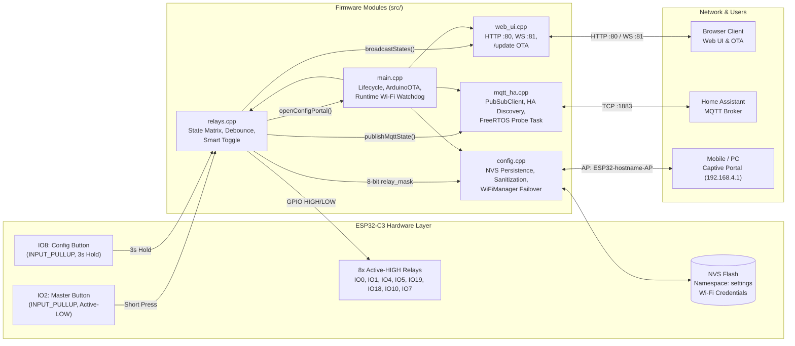
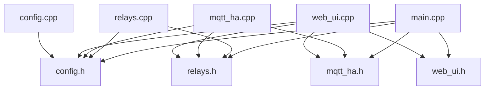
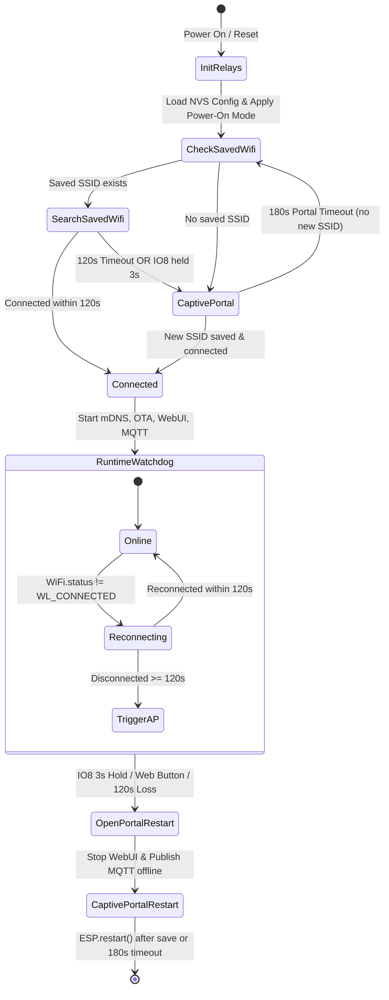
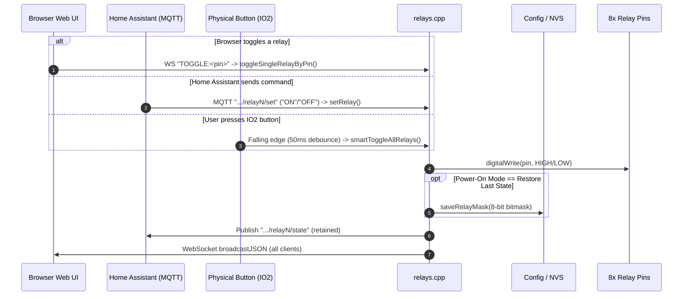
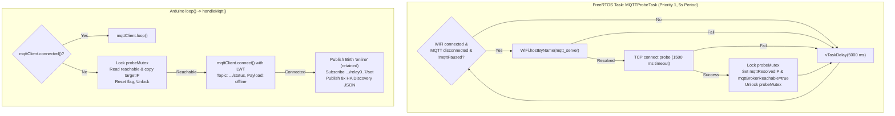
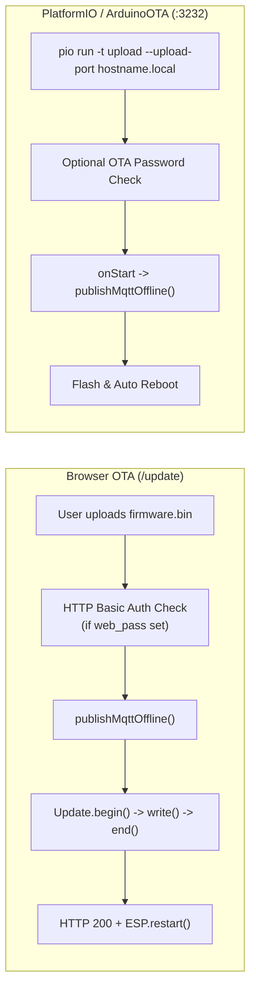

# System Architecture & Presentation Diagrams

This document provides end-to-end visual diagrams of the **ESP32-C3 8-Channel Smart Relay Controller** for architecture reviews and presentations.

---

## 1. High-Level Hardware & Software Block Diagram

---

## 2. Module Include & Dependency Graph

---

## 3. Wi-Fi Connection, 2-Minute Failover & Portal State Machine

---

## 4. Multi-Source Relay Control & Real-Time Synchronization

All control paths converge on `setRelay()` (or `setAllRelays()` for batch updates) so hardware, NVS, Home Assistant, and every open browser stay synchronized.

---

## 5. Non-Blocking FreeRTOS MQTT Probe & LWT Flow

Because DNS resolution (`homeassistant.local`) or a down broker can block TCP sockets for several seconds, probing runs on a low-priority FreeRTOS task guarded by `probeMutex`.

---

## 6. OTA Firmware Update Workflows

